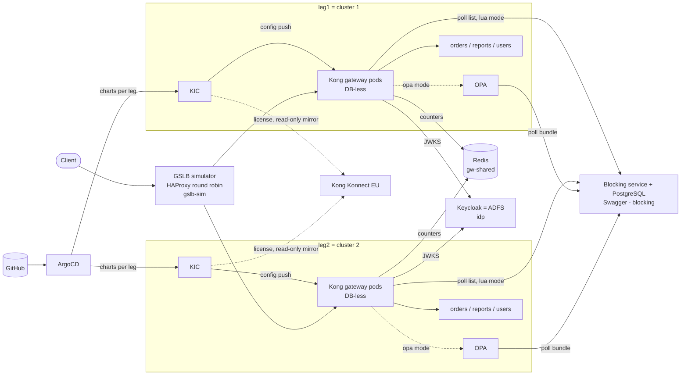

# Architecture

## Components



## Request flow (one request)

| Step | Plugin (priority) | What happens | On failure |
|---|---|---|---|
| 1 | GSLB | round robin to a leg (or pinned by `x-gslb-leg` in tests) | drained leg gets nothing |
| 2 | `openid-connect` (1050) | verifies signature (JWKS, cached), `exp`, `iss`, `aud`; `caller_id` claim becomes the authenticated credential; sets upstream `x-caller-id` | 401 |
| 3 | `blocklist` (1000) — Lua mode | in-memory lookup: route / caller / caller+route | 403 generic body |
| 3' | `opa` (920) — OPA mode | local call to the leg's OPA | 403 (OPA down → 500) |
| 4 | `rate-limiting-advanced` (910, ordered first) | per caller, sliding 60 s, Redis DB 0, namespace `<route>-user` → **one counter for all legs** | 429 |
| 5 | `rate-limiting` (910) | route-wide, Redis DB = leg number → **per leg** | 429 (Redis down → let through, `fault_tolerant`) |
| 6 | proxy | backend, timeouts from Service annotations | 502/504 |
| 7 | `file-log`, `prometheus` | JSON line with route, `caller_id`, leg, latency; metrics | — |

A blocked request (step 3) never reaches step 4/5, so it consumes no quota (acceptance test 8).

## Why two Redis "views" of one Redis

| Counter | Plugin | Redis DB | Key contains | Result |
|---|---|---|---|---|
| per caller on a route | `rate-limiting-advanced` | 0 (all legs) | explicit `namespace` `<route>-user` + caller | shared across legs, exact |
| route-wide | `rate-limiting` | 1, 2, … (one per leg) | route/service IDs (no namespace option) | per leg; in real clusters the IDs would be identical, so the DB is what separates them |

## Blocking: two mechanisms side by side

| | Lua `blocklist` | Kong `opa` + OPA per leg |
|---|---|---|
| Request path | shared-memory lookup, no I/O | HTTP call to the leg's OPA per request |
| List update | 1 poller per pod, every 5 s, `If-None-Match` | OPA polls the bundle every 2–4 s, `ETag` |
| Blocking service down | keeps last list | keeps last bundle |
| Before first list | `fail_open` (default 503) | policy allows (no data) |
| OPA down | — | 500 for every request (fail closed) |
| Identity | OIDC credential (`kong.client.get_credential().id`) | decodes the already verified JWT (`io.jwt.decode`) |
| Moving parts | plugin code (ConfigMap) | OPA Deployment + Rego (ConfigMap) |

Switch with `blocking.mode` in `charts/kong-global/values.yaml`: `lua` | `opa` | `both-observe` (OPA enforces,
Lua only marks `X-Blocklist-Would-Block`) | `off`.

## GitOps

```
argocd/root.yaml  (applied once by scripts/bootstrap.sh)
└── argocd/apps/
    ├── project.yaml           AppProject kong-poc
    ├── shared.yaml            kong-crds, redis, idp, blocking-service, gslb-sim
    ├── legs-kong.yaml         <leg>-kong            kong/ingress 0.24.0 + charts/kong-values/*
    ├── legs-charts.yaml       <leg>-kong-global, -opa, -orders, -reports, -users
    └── legs-code.yaml         <leg>-kong-plugin-blocklist, -opa-policy  (ConfigMaps)
```

The ApplicationSets read `environments/*.yaml`, so a new file there is a new leg. Value files per app:
`values.yaml` → `values-<app>.yaml` → `values-profile-<profile>.yaml` → `values-<leg>.yaml` →
`environments/<leg>.yaml`. Routes and thresholds change in Git → KIC pushes new config into the running
gateways (no restart). Blocks never go through Git.
